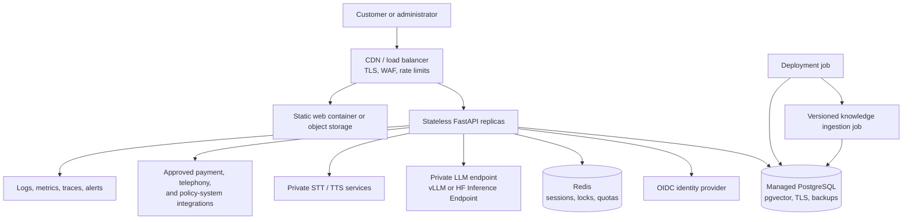

# Production Deployment Plan

**Status:** Proposed

**Last reviewed:** 2026-09-15

**Scope:** Move Assured from a synthetic demonstration to a secure, observable,
containerized production service with a Hugging Face-hosted model.

## Executive summary

Assured has a good demonstration baseline: the API and web app build as containers,
the test suite covers deterministic agent behavior, and providers are isolated behind
interfaces. It is not ready to process real customer data. The release blockers are
application authentication, durable session state, demo-only identity controls,
production model serving, scalable retrieval, container hardening, and operational
controls.

The recommended model architecture is a dedicated inference service rather than loading
Hugging Face `transformers` into each FastAPI worker. The API should call a private,
OpenAI-compatible endpoint backed by either:

1. a pinned vLLM container on managed GPU infrastructure; or
2. a private Hugging Face Inference Endpoint when managed scaling and operations are
   preferable.

This keeps the web/API tier stateless and independently scalable, prevents model weights
from being duplicated across API workers, and gives inference its own batching,
backpressure, health checks, and resource limits.

## Scope boundaries

This plan distinguishes two release targets:

- **Public synthetic demo:** No real users, PII, policy systems, or live payments. This
  still requires endpoint protection, abuse controls, hardened containers, and reliable
  model serving.
- **Real customer production:** Includes customer and administrator identity, real
  insurance records, production integrations, formal security/privacy controls, data
  retention, incident response, and applicable legal and vendor reviews.

Completing the public-demo track does not authorize the service to handle real customer
data. Real-customer launch requires every P0 and P1 gate in this document plus formal
organizational approval.

## Current state and verified gaps

As of the review date:

- 42 backend tests pass and Ruff reports no findings.
- Docker Compose validates, and the API and web images build.
- The frontend TypeScript/Vite production build succeeds.
- The standard API image does not contain `torch` or `transformers`; selecting the
  `huggingface` provider with the default build will fail.
- The API and web images run as root.
- No `.dockerignore` exists, so unnecessary local content is sent to the Docker builder.
- CI exercises mock providers but does not build, scan, or test the production model
  path.

The highest-risk implementation gaps are:

| Area | Current behavior | Production consequence |
|---|---|---|
| Authentication | Customer and admin routes have no application identity | Conversation and operational data can be accessed without a trusted principal |
| Conversation ownership | A caller can submit an arbitrary existing conversation ID | A leaked or discovered ID can be used to attach to another conversation |
| Session storage | Verification and pending actions are held in process memory | State is lost on restart and differs across workers or replicas |
| Demo identity | A fixed OTP and a public synthetic customer directory are enabled | Demo controls cannot be allowed in a real environment |
| LLM runtime | Direct `transformers` loading occurs in the API process | Model memory is duplicated, concurrency is unbounded, and API scaling is coupled to GPU scaling |
| Channel consistency | REST returns the deterministic draft while WebSockets stream an LLM rewrite | The displayed, returned, and persisted answers can differ |
| Retrieval | Dense search loads all candidate embeddings into API memory | Search cost grows linearly; the `pgvector` setting does not currently perform database vector search |
| Startup | Every API replica runs migrations and knowledge ingestion | Deployments can race and model-backed ingestion delays every replica startup |
| Readiness | `/ready` checks only PostgreSQL and returns HTTP 200 when not ready | An orchestrator can route traffic to a nonfunctional instance |
| Supply chain | Broad dependency ranges, mutable image tags, and no image scan/sign step | Builds are not reproducible and dependency changes can reach production unreviewed |

## Target architecture

Only the edge tier is public. PostgreSQL, Redis, the model endpoint, speech services, and
administrative telemetry remain on private networks. Production orchestration may use
Kubernetes, ECS, or another managed container platform; Docker Compose remains the local
development and single-host demonstration tool.

## Required decisions

Resolve these before implementation begins because they affect model packaging,
authentication, and infrastructure:

| Decision | Options | Recommended default |
|---|---|---|
| Launch scope | Synthetic public demo / real customer service | Harden the synthetic demo first; approve real data separately |
| Inference ownership | Managed Hugging Face endpoint / self-hosted vLLM | Managed endpoint for fastest launch; vLLM when infrastructure control or data residency requires it |
| Runtime hardware | CPU / single GPU / multi-GPU | Benchmark a single supported GPU with one warm replica |
| Model | Commercially permitted instruct model selected by evaluation | Start with a small-to-mid-sized instruct model because the LLM only phrases grounded facts |
| Customer identity | Existing company IdP / new hosted OIDC | Integrate the existing company IdP where available |
| Admin identity | Workforce SSO with RBAC | Required; do not share customer authentication |
| Session store | Redis / PostgreSQL | Redis for short-lived state with PostgreSQL audit records |
| Hosting platform | Kubernetes / ECS / other managed containers | Use the platform already operated by the organization |
| Data boundary | Private network / third-party endpoint | Private connectivity; prohibit unapproved PII transmission |

Record final choices as architecture decision records before the corresponding workstream
is marked complete.

## Workstream P0: security and identity

P0 work blocks every Internet-accessible production deployment.

### P0.1 Customer authentication and conversation ownership

**Deliverables**

- Integrate OIDC/OAuth authentication and validate issuer, audience, signature, expiry,
  and nonce/state as applicable.
- Create an application principal containing a stable subject and authorized customer ID.
- Bind each conversation to that principal on creation.
- Require the same principal for REST, chat WebSocket, and voice WebSocket access.
- Treat a conversation ID only as a record locator, never as authorization.
- Return 401 for missing/invalid identity and 403 for valid identities lacking access.

**Exit gate**

- An authenticated user can access only their conversations and owned records.
- A valid conversation ID copied from another user is rejected on every channel.
- Automated tests cover REST, WebSocket, reconnect, expiry, and logout/revocation.

### P0.2 Administrator authentication and authorization

**Deliverables**

- Protect all `/api/admin/*` routes with workforce SSO.
- Define explicit roles such as support viewer, support operator, evaluator, and platform
  administrator.
- Apply least-privilege permissions to transcript, customer, tool, ticket, and evaluation
  data.
- Audit administrative reads and mutations.
- Disable the demo customer endpoint outside an explicit demo environment.

**Exit gate**

- Anonymous and customer identities cannot access any administrative route.
- Each role has positive and negative authorization tests.
- Administrative access is visible in immutable audit records.

### P0.3 Durable session and transaction state

**Deliverables**

- Replace the process-local session dictionary with a Redis- or database-backed store.
- Persist verification state, satisfied-factor labels, pending claims, pending payments,
  expiry, and revocation state.
- Use atomic updates or locks for state transitions that may be processed concurrently.
- Enforce `session_ttl_seconds`; clear sensitive state at expiry and logout.
- Do not restore a verified state from a conversation row without a valid authenticated
  session.

**Exit gate**

- A session behaves consistently through API restarts and across at least two replicas.
- Concurrent payment or claim confirmations cannot execute twice.
- Expired and revoked sessions fail closed.

### P0.4 Replace demonstration verification

**Deliverables**

- Remove the fixed OTP from production configuration.
- Integrate an approved OTP/MFA or customer identity workflow.
- Rate-limit verification attempts across sessions, principals, and relevant network
  signals.
- Prevent factor enumeration and keep failure messages nondisclosing.
- Add production startup validation that rejects demo OTP, mock payment, demo seed, open
  CORS, or default database credentials.

**Exit gate**

- `INSURANCE_AI_ENVIRONMENT=prod` cannot start with any demo security control enabled.
- Verification abuse and lockout tests pass across multiple replicas.

### P0.5 Edge, input, and integration protection

**Deliverables**

- Replace wildcard CORS with the exact deployed origins.
- Validate WebSocket origins and authenticate before accepting a stream.
- Bound JSON bodies, message lengths, audio buffers, WebSocket frames, and generation
  tokens.
- Add per-principal and per-IP rate limits plus global concurrency limits.
- Verify every Stripe and Twilio signature; reject unsigned requests.
- Add replay protection and idempotency keys for external events and mutations.
- Configure TLS, secure headers, trusted proxy handling, and safe request logging.

**Exit gate**

- Abuse tests demonstrate bounded memory and generation concurrency.
- Invalid/replayed webhooks are rejected with appropriate HTTP status codes.
- External penetration testing has no unresolved critical or high findings.

## Workstream P1: Hugging Face model serving

### P1.1 Select and govern the model

**Deliverables**

- Build an evaluation shortlist of instruction-tuned models supported by the selected
  inference engine and hardware.
- Review each model card, license, acceptable-use restrictions, context length, chat
  template, and required remote code.
- Prefer trusted publishers and `safetensors`; do not enable arbitrary
  `trust_remote_code` in production.
- Pin the model repository to an immutable commit revision.
- Record the model ID, revision, tokenizer revision, quantization, inference-engine
  version, and prompt-template version in each trace.

**Model acceptance tests**

- No unsupported policy, claim, billing, or identity facts are added.
- Citations and required disclaimers survive phrasing.
- Prompt-injection and data-exfiltration cases fail closed.
- The model does not expose unrelated transcript or customer data.
- Output quality, first-token latency, total latency, throughput, and GPU memory meet the
  approved service-level objectives under concurrent load.

### P1.2 Create the inference service

**Self-hosted path**

- Add a dedicated, version-pinned vLLM container with an OpenAI-compatible API.
- Attach only the required GPU resources and a read-only/persistent model cache.
- Keep the service on a private network and require an internal credential or workload
  identity.
- Configure maximum context length, batched tokens, sequences, GPU utilization, request
  queue depth, and generation limits from measured capacity.
- Add startup, liveness, readiness, and model-warmup probes.

**Managed path**

- Provision a private Hugging Face Inference Endpoint at an immutable model revision.
- Configure approved region, networking, minimum/maximum replicas, authentication,
  audit access, and budget alerts.
- Keep at least one replica warm for interactive voice unless measured cold-start behavior
  meets the user experience target.

**Exit gate**

- The model endpoint survives restart, overload, timeout, and downstream disconnect tests.
- Capacity tests define a safe maximum concurrent request count per replica.
- No model port is reachable from the public Internet unless explicitly required and
  protected by the approved gateway.

### P1.3 Refactor the API provider

**Deliverables**

- Add an explicit remote provider configuration instead of overloading `openai` or the
  in-process `huggingface` provider.
- Reuse a persistent asynchronous HTTP client with connection pooling.
- Support streaming cancellation, connect/read/overall timeouts, bounded retry with
  jitter, and a circuit breaker.
- Forward request IDs and capture endpoint/model telemetry without logging prompts that
  contain sensitive data.
- Apply backpressure before calling the model service.
- Keep the direct `HFTransformersLLM` adapter as development-only, or remove it after the
  remote path is established.

**Exit gate**

- Contract tests pass against the pinned inference-server image.
- API replicas can scale independently without duplicating model weights.
- A failed or overloaded model returns a controlled fallback rather than hanging a
  request.

### P1.4 Make generated output authoritative and safe

**Deliverables**

- Use one generation flow for REST, chat WebSocket, voice, persistence, and traces.
- Validate the model rewrite against the deterministic grounded draft.
- Reject unsupported numbers, identifiers, coverage statements, URLs, and citations.
- Fall back to the deterministic draft when validation or inference fails.
- Persist the exact user-visible answer and its model metadata.

**Exit gate**

- The streamed, final, and persisted answer are identical for every channel.
- Fault-injection tests prove the deterministic fallback works during model errors and
  grounding-validation failures.

## Workstream P1: data and retrieval

### P1.5 Implement real pgvector retrieval

**Deliverables**

- Add a dimensioned pgvector column through an explicit Alembic migration.
- Create the selected HNSW or IVFFlat index and supporting metadata filters.
- Execute top-k similarity search in PostgreSQL rather than loading all vectors into API
  memory.
- Validate embedding dimensions when configuration changes.
- Version embeddings by model, revision, dimensions, and knowledge-corpus version.
- Keep the numpy/BM25 path only for tests and small offline demos.

**Exit gate**

- Query plans use the intended vector index at production-like corpus size.
- Retrieval quality meets the approved recall/precision evaluation threshold.
- Latency remains within its SLO under concurrent chat and ingestion load.

### P1.6 Separate migrations, seeding, and ingestion

**Deliverables**

- Run Alembic once as a release job before new application replicas receive traffic.
- Never seed synthetic customers in production.
- Move knowledge ingestion to an explicit, idempotent job keyed by content hashes and
  embedding version.
- Add safe retry, progress tracking, validation, and rollback for ingestion.
- Test forward and rollback migration behavior on a production-like copy.

**Exit gate**

- Starting an API replica neither changes schema nor re-embeds the corpus.
- Concurrent deploys cannot run conflicting migrations or duplicate ingestion.

### P1.7 Production database controls

**Deliverables**

- Use managed PostgreSQL with TLS, private networking, least-privilege roles, encrypted
  storage, automated backups, and point-in-time recovery.
- Configure and measure connection-pool sizes against total replica capacity.
- Add data classification, retention, deletion, export, and legal-hold behavior for
  transcripts, traces, tool arguments/results, audio, and customer records.
- Review indexes, foreign-key deletion behavior, monetary types, concurrency controls,
  and transaction idempotency.

**Exit gate**

- A restore drill meets the approved recovery-point and recovery-time objectives.
- Retention and customer-deletion tests cover all derived and audit data stores.

## Workstream P1: containers and delivery

### P1.8 Harden application images

**Deliverables**

- Add `.dockerignore` for `.git`, virtual environments, `node_modules`, caches, local
  databases, logs, secrets, model weights, and build outputs.
- Use multi-stage API builds with a locked production dependency set.
- Remove editable installs, development tools, and ignored install failures.
- Run API and web processes as dedicated non-root users.
- Use a read-only root filesystem and explicitly writable temporary/cache mounts.
- Pin base images by digest and keep OS packages minimal.
- Add graceful shutdown and termination timing for HTTP and WebSocket traffic.

**Exit gate**

- Images contain no compilers, test tools, package caches, source secrets, or writable
  application directories unless required.
- Runtime security policy confirms non-root, least capability, and resource limits.

### P1.9 Production deployment definitions

**Deliverables**

- Keep `docker-compose.yml` optimized for local development.
- Add environment-specific deployment definitions for the selected orchestrator.
- Define separate web, API, migration, ingestion, model, and optional speech workloads.
- Configure replicas, disruption budgets, affinity, resources, autoscaling, private
  networking, secret references, and rolling-update behavior.
- Terminate TLS at the approved edge and do not publish database/model ports.

**Exit gate**

- A clean staging environment can be created entirely from versioned definitions.
- Rolling deployment and rollback complete without losing established sessions or
  corrupting in-flight mutations.

### P1.10 Reproducible and secure delivery

**Deliverables**

- Lock Python dependencies with hashes and continue using `npm ci` for the frontend.
- Build all runtime images in CI.
- Generate an SBOM; scan dependencies, images, IaC, and committed secrets.
- Sign images and deploy by immutable digest.
- Add provenance/attestation and enforce approved registries in the runtime platform.
- Define automated rollback criteria and retain the previous known-good release.

**Exit gate**

- The same commit produces traceable images with reviewed dependency changes.
- Critical vulnerabilities and unapproved licenses block release.

## Workstream P1: reliability and observability

### P1.11 Health, resilience, and overload behavior

**Deliverables**

- Separate liveness from readiness.
- Return HTTP 503 from readiness when required dependencies are unavailable.
- Include database, Redis/session store, model-service connectivity, provider
  initialization, and required configuration in readiness.
- Add timeouts, bulkheads, circuit breakers, bounded queues, and deterministic fallback.
- Gracefully drain HTTP/WebSocket traffic and cancel downstream generation on shutdown or
  disconnect.

**Exit gate**

- Failure injection for database, Redis, model, STT, TTS, and integrations produces the
  documented degraded behavior.
- Overload returns controlled 429/503 responses without unbounded memory growth.

### P1.12 Metrics, traces, logs, and alerts

**Deliverables**

- Emit RED metrics for each API and provider: request rate, errors, and duration.
- Track active streams, queue depth, first-token latency, first-audio latency, tokens per
  second, generation cancellations, grounding fallbacks, and GPU utilization/memory.
- Propagate a request/trace ID through web, API, tools, model, speech, and external calls.
- Redact or omit PII, credentials, raw identity factors, payment data, and sensitive
  prompts from logs.
- Add dashboards and actionable alerts linked to runbooks.

**Exit gate**

- An operator can identify a failing dependency and affected release from one request ID.
- Alert drills reach the on-call owner with enough context to act.

### P1.13 Define service objectives

Approve measurable targets before capacity testing. At minimum define:

- availability for chat and voice;
- p50/p95/p99 REST latency;
- transcript-to-first-token and speech-end-to-first-audio latency;
- model error, timeout, and grounding-fallback rates;
- maximum accepted concurrent conversations;
- recovery point and recovery time objectives; and
- support/escalation delivery time.

The first release must use targets measured on the selected model, quantization,
hardware, corpus, and realistic concurrent traffic. Mock-provider latency is not evidence
for a production SLO.

## Workstream P1: verification and release safety

### P1.14 Expand automated testing

Add CI or scheduled suites for:

- authentication, authorization, conversation ownership, and role matrices;
- multi-replica session continuity and concurrent mutation/idempotency;
- production configuration rejection tests;
- model-server contract and real-model behavioral evaluations;
- grounding validation, injection, PII leakage, and deterministic fallback;
- pgvector query correctness, index use, and embedding migration;
- Alembic upgrade/rollback and knowledge-ingestion idempotency;
- webhook signatures and replay protection;
- container startup/readiness and end-to-end browser/WebSocket smoke tests; and
- load, soak, failure-injection, and graceful-shutdown behavior.

Real-model evaluation should run against a pinned model revision. Because generation may
not be byte-for-byte deterministic, assert required facts, forbidden claims, source
preservation, safety properties, and statistical latency/quality thresholds rather than
exact prose.

### P1.15 Staging, canary, and launch process

**Deliverables**

- Maintain an isolated staging environment with production-equivalent networking and
  managed services but synthetic data.
- Run migration, restore, rollback, key-rotation, scaling, and incident exercises.
- Canary application and model revisions independently.
- Require explicit security, privacy, model-risk, operations, and product approvals for a
  real-customer launch.
- Document kill switches for model generation, voice, payments, telephony, and mutating
  tools.

**Exit gate**

- The release candidate completes the agreed soak period without unresolved severity-one
  or severity-two defects.
- Rollback and kill-switch exercises succeed within the approved time objective.

## P2 follow-up improvements

These are not substitutes for the P0/P1 gates but should follow the first stable release:

- Autoscale the API on active requests and the model tier on pending generations or
  measured GPU capacity.
- Serve embeddings from a dedicated Hugging Face Text Embeddings Inference service when
  corpus/query volume justifies it.
- Add model shadowing and offline comparison before model upgrades.
- Add automated drift, retrieval-quality, and grounded-answer trend reporting.
- Add regional failover if required by the availability objective.
- Add privacy-preserving analytics and sampled conversation review workflows.
- Evaluate whether STT and TTS should become separately scaled services.

## Milestones and dependency order

| Milestone | Included work | Depends on | Completion signal |
|---|---|---|---|
| M0: Decisions | Scope, platform, identity, data boundary, model-serving path, initial SLOs | None | Approved ADRs and named owners |
| M1: Secure application | P0.1-P0.5 | M0 identity and scope | Public exposure is safe for synthetic staging traffic |
| M2: Model service | P1.1-P1.4 | M0 hardware and hosting | Pinned real model passes quality, safety, and capacity gates |
| M3: Data/runtime | P1.5-P1.10 | M0 platform; M2 embedding choice | Reproducible hardened deployment with scalable retrieval |
| M4: Operability | P1.11-P1.14 | M1-M3 | SLO dashboards, alerts, resilience tests, and CI release gates pass |
| M5: Launch | P1.15 and organizational approvals | M1-M4 | Staging soak, restore, rollback, and sign-offs complete |

Security work and model evaluation can proceed in parallel after M0. Data schema work
must know the selected embedding model and dimension. Capacity planning must use the
selected LLM revision and inference engine, not a placeholder model.

## Production configuration contract

Add validated settings for at least:

- allowed HTTP and WebSocket origins;
- OIDC issuer, audience, JWKS discovery, and role mapping;
- session backend, TTL, cookie/security settings, and encryption/signing keys;
- Redis and PostgreSQL TLS URLs and pool limits;
- remote LLM URL, credential reference, model ID/revision, timeout, token, context, and
  concurrency limits;
- embedding model/revision/dimension and corpus version;
- trusted proxy ranges and public URL;
- request/audio/frame limits and rate-limit policies;
- telemetry endpoint, sampling, redaction, and environment/release identity;
- demo feature flags that are structurally disabled in production; and
- integration credentials and mandatory webhook secrets.

Production startup must validate combinations rather than merely individual fields. For
example, `environment=prod` plus `llm_provider=mock`, the demo OTP, wildcard CORS, an
unverified webhook, or a default database password must be a fatal configuration error.

## Launch checklist

The release owner must be able to answer **yes** to every item:

- [ ] The environment contains no real data unless the real-customer track is approved.
- [ ] Customer and administrator identities are authenticated and separately authorized.
- [ ] Conversation IDs cannot grant access by themselves.
- [ ] Sessions survive restarts, expire, revoke, and behave consistently across replicas.
- [ ] Demo OTP, demo customer discovery, automatic seeding, and mock providers are off.
- [ ] The model and all images are pinned, scanned, signed, and traceable to this commit.
- [ ] The model passes grounded-output, injection, leakage, quality, latency, and load
      gates.
- [ ] User-visible, returned, persisted, and audited answers are identical.
- [ ] Database retrieval uses the intended pgvector index at production scale.
- [ ] Migrations and knowledge ingestion run as controlled release jobs.
- [ ] Database backup restoration and application rollback have been exercised.
- [ ] Readiness accurately removes unhealthy API/model replicas from service.
- [ ] Rate limits and bounded queues protect HTTP, WebSocket, audio, and model resources.
- [ ] Stripe/Twilio or other external requests are authenticated and replay-safe.
- [ ] Logs and traces exclude prohibited sensitive content.
- [ ] Dashboards, alerts, runbooks, on-call ownership, SLOs, and kill switches are active.
- [ ] The staging soak and required security/privacy/model-risk approvals are complete.

## Definition of done

Assured is production-ready only when the selected release scope has passed all applicable
P0 and P1 exit gates, the launch checklist is complete, and the deployed artifacts are
immutable outputs of the reviewed commit. A successful local Compose launch or a passing
mock-provider test suite is necessary development evidence, but is not the production
readiness decision.
